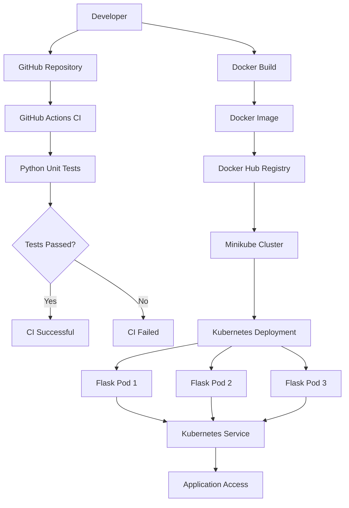
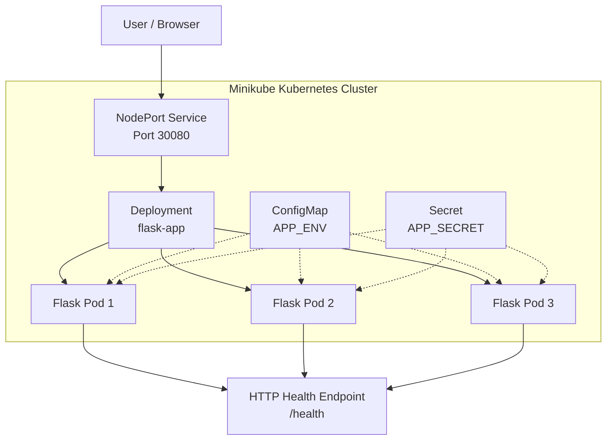
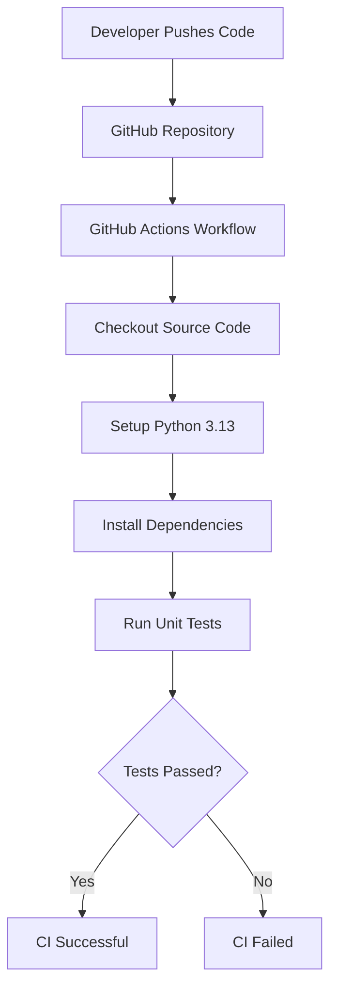

# Kubernetes-Based Flask Application Deployment

[](https://github.com/Fahari04/kubernetes-flask-deployment/actions/workflows/ci.yml)
[](https://hub.docker.com/r/fahari04/flask-kubernetes-app)

A practical DevOps portfolio project demonstrating how to develop, containerize, deploy, and manage a Python Flask application using Docker, Kubernetes, Minikube, Docker Hub, and GitHub Actions.

The project covers containerization, Kubernetes orchestration, application scaling, health monitoring, rolling updates, rollback, and continuous integration.

---

## Table of Contents

- [Project Overview](#project-overview)
- [Technology Stack](#technology-stack)
- [System Architecture](#system-architecture)
- [Kubernetes Architecture](#kubernetes-architecture)
- [CI Pipeline Architecture](#ci-pipeline-architecture)
- [Project Structure](#project-structure)
- [Application Endpoints](#application-endpoints)
- [Local Development](#local-development)
- [Docker Implementation](#docker-implementation)
- [Docker Hub](#docker-hub)
- [Kubernetes Deployment](#kubernetes-deployment)
- [Kubernetes Features](#kubernetes-features)
- [Continuous Integration](#continuous-integration)
- [Testing](#testing)
- [Security Considerations](#security-considerations)
- [Skills Demonstrated](#skills-demonstrated)
- [Future Improvements](#future-improvements)
- [Repository Links](#repository-links)

---

## Project Overview

The objective of this project is to build and deploy a containerized Flask application on a local Kubernetes cluster.

The application is developed using Python and Flask, packaged into a Docker image, published to Docker Hub, and deployed using Kubernetes Deployments and Services.

GitHub Actions is configured to automatically execute application tests whenever code is pushed to the `main` branch or a pull request is created.

The project also demonstrates practical Kubernetes operations, including:

- Managing application Pods using Deployments.
- Exposing applications using Kubernetes Services.
- Managing configuration using ConfigMaps and Secrets.
- Configuring readiness and liveness probes.
- Scaling application replicas.
- Performing rolling updates.
- Rolling back to previous application versions.
- Monitoring application health and Pod status.

## Technology Stack

| Technology | Purpose |
|---|---|
| Python 3.13 | Application development |
| Flask | Web application framework |
| Gunicorn | Python application server |
| Docker | Application containerization |
| Docker Hub | Container image registry |
| Kubernetes | Container orchestration |
| Minikube | Local Kubernetes cluster |
| kubectl | Kubernetes cluster management |
| Git | Version control |
| GitHub | Source code repository |
| GitHub Actions | Continuous Integration |
| YAML | Application and Kubernetes configuration |

---

## System Architecture

The following diagram illustrates the overall application architecture, from source code development to Kubernetes deployment.



**Architecture explanation:**

1. The developer maintains the application source code in GitHub.
2. GitHub Actions runs automated Python tests.
3. Docker builds the application container image.
4. Docker Hub stores published application image versions.
5. Minikube runs the local Kubernetes cluster.
6. Kubernetes Deployment manages three Flask application replicas.
7. Kubernetes Service provides access to the application.

Note: Docker image publishing and Kubernetes deployment are currently performed manually. Automated Docker Hub publishing through GitHub Actions is a planned improvement.

---

## Kubernetes Architecture

The following diagram illustrates the Kubernetes resources used in this project.



**Kubernetes resources:**

| Resource | Name | Purpose |
|---|---|---|
| Deployment | `flask-app` | Manages application replicas |
| Service | `flask-service` | Exposes application traffic |
| ConfigMap | `flask-config` | Stores application configuration |
| Secret | `flask-secret` | Demonstrates sensitive configuration management |
| Pods | `flask-app-*` | Run Flask application containers |

The Deployment is configured with three replicas, resource requests and limits, readiness probes, and liveness probes.

The Service uses NodePort `30080` and forwards traffic to the Flask application on port `5000`.

---

## CI Pipeline Architecture

GitHub Actions is used for Continuous Integration.



The current CI workflow performs:

1. Repository checkout.
2. Python 3.13 environment setup.
3. Application dependency installation.
4. Automated unit test execution.

The workflow runs on pushes and pull requests targeting the `main` branch.

---

## Project Structure

```text
kubernetes-flask-deployment/
│
├── .github/
│   └── workflows/
│       └── ci.yml
│
├── app/
│   ├── __init__.py
│   ├── app.py
│   └── requirements.txt
│
├── k8s/
│   ├── configmap.yaml
│   ├── deployment.yaml
│   ├── secret.yaml
│   └── service.yaml
│
├── tests/
│   └── test_app.py
│
├── .dockerignore
├── .gitignore
├── Dockerfile
└── README.md
```

---

## Application Endpoints

The Flask application provides the following endpoints:

| Endpoint | Method | Description |
|---|---|---|
| `/` | GET | Returns application status and environment information |
| `/health` | GET | Returns application health status |

Example health response:

```json
{
  "status": "healthy"
}
```

---

## Local Development

### Prerequisites

Install the following tools:

- Python 3.13
- Git
- Docker Desktop
- Kubernetes kubectl
- Minikube
- Visual Studio Code (optional)

### Clone the Repository

```powershell
git clone https://github.com/Fahari04/kubernetes-flask-deployment.git
```

Navigate to the project directory:

```powershell
cd kubernetes-flask-deployment
```

### Install Dependencies

```powershell
py -m pip install -r app/requirements.txt
```

### Run the Application

```powershell
py -m flask --app app.app run --host=0.0.0.0 --port=5000
```

Access the application:

- http://localhost:5000/
- http://localhost:5000/health

---

## Docker Implementation

The application is containerized using a Dockerfile based on Python 3.13 Slim.

### Build Docker Image

```powershell
docker build -t flask-kubernetes-app:1.0 .
```

### Run Docker Container

```powershell
docker run -d --name flask-demo -p 5000:5000 flask-kubernetes-app:1.0
```

### Verify Running Container

```powershell
docker ps
```

### View Container Logs

```powershell
docker logs flask-demo
```

### Access Application

- http://localhost:5000/
- http://localhost:5000/health

---

## Docker Hub

The application images are published to Docker Hub.

**Docker Hub Repository:**

[https://hub.docker.com/r/fahari04/flask-kubernetes-app](https://hub.docker.com/r/fahari04/flask-kubernetes-app)

### Published Image Versions

| Image | Version |
|---|---|
| `fahari04/flask-kubernetes-app` | `1.0` |
| `fahari04/flask-kubernetes-app` | `1.1` |

### Pull Docker Image

```powershell
docker pull fahari04/flask-kubernetes-app:1.0
```

```powershell
docker pull fahari04/flask-kubernetes-app:1.1
```

---

## Kubernetes Deployment

The application is deployed to a local Kubernetes cluster using Minikube.

### 1. Start Minikube

```powershell
minikube start --driver=docker
```

### 2. Verify Cluster

```powershell
kubectl get nodes
```

### 3. Apply Kubernetes Configuration

```powershell
kubectl apply -f k8s/configmap.yaml
kubectl apply -f k8s/secret.yaml
kubectl apply -f k8s/deployment.yaml
kubectl apply -f k8s/service.yaml
```

### 4. Verify Kubernetes Resources

```powershell
kubectl get deployments
kubectl get pods
kubectl get services
```

### 5. Access the Application

Port forwarding:

```powershell
kubectl port-forward service/flask-service 8081:80
```

Open the application:

- http://localhost:8081/
- http://localhost:8081/health

---

## Kubernetes Features

### 1. Application Deployment

Deployed the Flask application using Kubernetes Deployment.

Configured three application replicas to maintain the desired number of running Pods.

```powershell
kubectl get deployments
kubectl get pods
```

### 2. Kubernetes Service

Configured a NodePort Service to expose the Flask application.

- Service port: `80`
- Target port: `5000`
- NodePort: `30080`

### 3. ConfigMap and Secret

Used ConfigMap to manage application environment configuration.

Used Kubernetes Secret to demonstrate sensitive configuration management.

### 4. Health Monitoring

Configured HTTP-based readiness and liveness probes using the `/health` endpoint.

These probes allow Kubernetes to monitor application readiness and health.

### 5. Resource Management

Configured container resource requests and limits.

| Resource | Request | Limit |
|---|---:|---:|
| CPU | 100m | 500m |
| Memory | 128Mi | 256Mi |

### 6. Horizontal Scaling

Practised scaling the application from two replicas to three replicas.

```powershell
kubectl scale deployment flask-app --replicas=3
```

Verify:

```powershell
kubectl get pods
```

### 7. Rolling Updates

Updated the application from version `1.0` to version `1.1`.

```powershell
kubectl set image deployment/flask-app flask-app=flask-kubernetes-app:1.1
```

Monitor the rollout:

```powershell
kubectl rollout status deployment/flask-app
```

### 8. Rollback

Practised rolling back the application to the previous working version.

```powershell
kubectl rollout undo deployment/flask-app
```

Check deployment history:

```powershell
kubectl rollout history deployment/flask-app
```

### 9. Self-Healing

Practised deleting an application Pod and observing Kubernetes recreate a replacement to maintain the desired replica count.

```powershell
kubectl get pods
```

---

## Continuous Integration with GitHub Actions

GitHub Actions automates the application testing process.

**Workflow file:**

`.github/workflows/ci.yml`

### Current CI Workflow

- Triggered by pushes to `main`.
- Triggered by pull requests targeting `main`.
- Uses Ubuntu as the GitHub Actions runner.
- Sets up Python 3.13.
- Installs application dependencies.
- Executes automated unit tests.

The workflow has been successfully executed on GitHub Actions.

**Workflow status:** Passing.

### Run Tests Locally

```powershell
py -m unittest discover -s tests -v
```

---

## Testing

The project includes automated unit tests using Python's built-in `unittest` framework.

Current test coverage includes:

| Test | Description |
|---|---|
| Homepage test | Verifies the homepage returns HTTP 200 and success status |
| Health endpoint test | Verifies the health endpoint returns HTTP 200 and healthy status |

Both tests have successfully passed locally and through GitHub Actions.

---

## Security Considerations

Security practices considered in this project:

- `.gitignore` excludes local environment files and temporary files.
- No production credentials should be committed to the public repository.
- The Kubernetes Secret manifest contains a demonstration placeholder only.
- Kubernetes Secrets are not automatically encrypted simply because they are stored as Secret resources.
- Production deployments should use appropriate access controls and encryption at rest.
- Production credentials should be managed using secure secret management solutions.

---

## Skills Demonstrated

Through this project, the following technical skills have been practised:

**Containerization**
- Docker image creation
- Dockerfile configuration
- Container lifecycle management
- Docker Hub image publishing

**Kubernetes**
- Deployments and ReplicaSets
- Pods and Services
- ConfigMaps and Secrets
- Readiness and liveness probes
- Resource requests and limits
- Application scaling
- Rolling updates and rollback
- Pod self-healing

**CI and Version Control**
- Git version control
- GitHub repository management
- GitHub Actions workflow configuration
- Automated Python testing

**Application Development**
- Python
- Flask
- Gunicorn
- REST-style HTTP endpoints
- Unit testing

---

## Future Improvements

Potential future enhancements include:

- Automate Docker image building and publishing through GitHub Actions.
- Add automated deployment workflows.
- Expand unit and integration test coverage.
- Introduce application monitoring and observability.
- Improve Kubernetes security and configuration management.

---

## Repository Links

**GitHub Repository:**

[https://github.com/Fahari04/kubernetes-flask-deployment](https://github.com/Fahari04/kubernetes-flask-deployment)

**Docker Hub Repository:**

[https://hub.docker.com/r/fahari04/flask-kubernetes-app](https://hub.docker.com/r/fahari04/flask-kubernetes-app)

---

*Developed as a practical DevOps and Kubernetes portfolio project.*